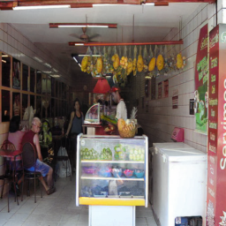
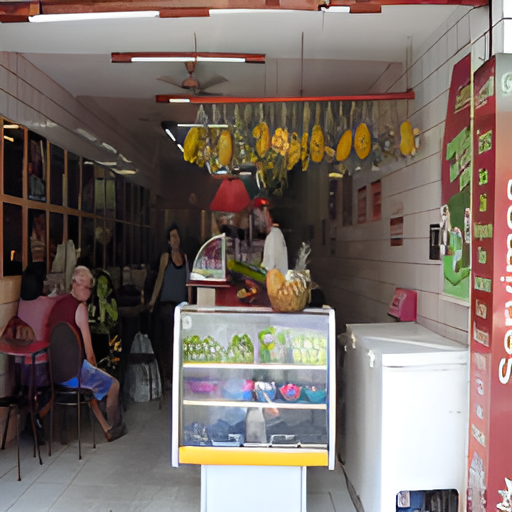
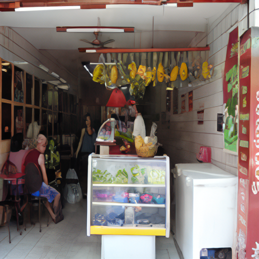

# 2025 Inha AI Challenge: 언어 기반 색채화·초해상도

흑백 이미지와 캡션으로 색채 이미지를 생성한 대학원 팀 **5층**의 프로젝트입니다. 팀원은 이지호·고영호·박민수·홍석환이며, 대학원 부문 우수상을 수상했습니다.

[프로젝트 과정과 결과를 읽는 블로그 글](https://seokhwanhong.github.io/projects/inha-colorization-super-resolution/)

## 목표와 데이터

캡션이 제공하는 색·객체 단서를 흑백 이미지에 반영하고, 색채화 뒤 초해상도로 출력 해상도를 복원합니다.

| 구분 | 구성 |
| --- | --- |
| 학습 자료 | 흑백·정답 색채 이미지 65,260장과 경로·캡션 |
| 평가 자료 | 흑백 이미지 200장, 캡션, 샘플 ID |
| 평가 | `0.6 × HSV Similarity + 0.4 × CLIP Score` |
| 실행 범위 | 사전학습 모델 추론. 제공 학습 데이터로 재학습하지 않음 |

HSV는 실제·생성 이미지의 색 히스토그램 유사도 평균, CLIP은 캡션과 생성 이미지 간 코사인 유사도입니다. 발표자료는 CLIP 모델로 ViT-L-14를 명시합니다.

## 접근과 실험 과정

기준 접근은 Canny edge를 ControlNet의 구조 조건으로 전달하고, 캡션과 함께 Stable Diffusion으로 추론하는 방식입니다. 발표자료의 기준 설정은 guidance scale 7.5, 추론 50단계입니다. 이 값은 L-CAD 실행 설정을 의미하지 않습니다.

최종 파이프라인은 512×512 흑백 입력을 256×256으로 축소하고, L-CAD 색채화와 SwinIR 2배 복원을 순차 적용해 512×512 이미지를 생성합니다. 이후 ID별 이미지에서 CLIP 임베딩을 추출하고 제출 ZIP을 만듭니다.

L-CAD의 128×128·256×256 출력과 Real-ESRGAN·SwinIR·ResShift 출력을 비교했습니다. 현재 공개 코드가 담당하는 범위는 **색채화 결과를 입력받은 이후의 SwinIR 복원과 제출 파일 생성**입니다.

본인 설명에 따르면 색채화와 해상도 복원의 입출력을 연결하고, 2배·4배 복원을 비교하는 것을 목표로 후보를 실행했습니다. 입력 축소에는 동일한 보간 방식을 적용했으며, 시도한 4배 설정에서는 기대한 성능을 얻지 못했던 것으로 기억합니다. 공개 코드에는 다운스케일링과 전체 후보 실행 경로가 없어 **보간 알고리즘, 모델별 축소·입력 크기, 4배 출력의 최종 크기 조정 과정, 모든 후보에 동일한 색채화 출력을 사용했는지**는 원본 코드·발표자료로 추가 확인해야 합니다. 동일한 보간 방식을 사용했다는 설명만으로 모든 비교 조건이 같았다고 볼 수는 없습니다.

## 결과와 비교 조건

| 모델 | 발표자료의 복원 배율 | Public | Private |
| --- | ---: | ---: | ---: |
| Real-ESRGAN | 2배 | 0.6700 | 미기록 |
| SwinIR | 2배 | **0.6830** | **0.6925** |
| ResShift | 4배 | 0.6652 | 미기록 |

SwinIR은 **기록된 제출 후보 중 Public 점수가 가장 높은 조합**이었습니다. 본인 설명에 따르면 후보의 출력과 제출 점수를 비교해 SwinIR 2배 복원 조합을 최종 제출에 사용했습니다. 공개 점수 차이는 Real-ESRGAN 대비 0.0130, ResShift 대비 0.0178입니다.

모델·배율·크기 처리 등 비교 조건이 달라 점수 차이의 원인을 배율이나 모델 구조 하나로 단정할 수는 없습니다. 이번에 시도한 4배 설정에서 기대한 결과를 얻지 못했다는 회고를 4배 복원이 일반적으로 열등하다는 결론으로 확대하지 않습니다. ResShift의 출력 예시는 발표자료에 512×512로 표시돼 있지만 4배 결과의 최종 크기 조정 과정은 제공 코드에 없습니다. HSV·CLIP 개별 점수도 미기록입니다.

### 발표자료의 출력 예시


*128×128 색채화 출력*



*256×256 색채화 출력*



*Real-ESRGAN 출력*


*SwinIR 출력*



*ResShift 출력. 위 배율·크기 조정 관련 한계를 참고하세요.*

위 이미지는 팀 발표자료 15쪽에서 추출한 예시입니다. 한 장의 비교로 전체 점수 차이의 원인을 단정할 수는 없습니다.

## 저장소 구성

| 경로 | 내용 |
| --- | --- |
| `src/swinir.py` | SwinIR 2배 이미지 복원 |
| `src/submission.py` | CLIP 이미지 임베딩 CSV와 ZIP 생성 |
| `requirements.txt` | 의존 패키지 목록, 버전 고정 없음 |
| `images/` | 발표자료의 색채화·복원 출력 예시 |

L-CAD 추론 코드, Real-ESRGAN·ResShift 실행 코드, 데이터와 가중치는 이 디렉터리에 포함돼 있지 않습니다. 모델 전체 소스는 아래 공식 저장소에서 확인할 수 있습니다.

## 실행 환경과 준비

저장소 루트에서 다음 명령을 실행합니다.

```bash
cd inha-colorization-super-resolution
pip install -r requirements.txt
```

`requirements.txt`에는 torch, torchvision, basicsr, open-clip-torch, opencv-python, numpy, pandas, Pillow, tqdm이 있습니다. 버전이 고정돼 있지 않아 이 목록만으로 대회 당시 환경이 재현되지는 않습니다. CUDA 환경에 맞는 PyTorch를 준비하고, BasicSR의 `SwinIR` 임포트가 가능한지도 확인해야 합니다.

현재 `src/swinir.py`는 모델과 입력에 `.cuda()`를 직접 호출합니다. CPU 실행 옵션은 없습니다. 제출 스크립트는 CUDA 사용 가능 여부에 따라 GPU 또는 CPU를 선택합니다.

### SwinIR 가중치

공식 SwinIR 저장소의 다음 가중치를 준비합니다.

```text
SwinIR/weights/001_classicalSR_DF2K_s64w8_SwinIR-M_x2.pth
```

이 경로는 **명령을 실행하는 현재 디렉터리 기준**입니다. 위 `cd` 명령을 사용했다면 프로젝트 디렉터리 안에 `SwinIR/weights/`를 둡니다. 가중치 전체 경로는 코드에 고정돼 있으며 CLI 인자로 바꿀 수 없습니다. 코드가 읽는 체크포인트 키는 `params`입니다.

모델 설정은 `upscale=2`, `window_size=8`, `embed_dim=180`, `depths=[6,6,6,6,6,6]`, `num_heads=[6,6,6,6,6,6]`, `upsampler="pixelshuffle"`입니다. 해당 설정과 호환되는 가중치가 필요합니다.

### 색채화 입력 준비

L-CAD 공식 코드와 가중치로 256×256 색채화 이미지를 먼저 생성해야 합니다. 이 저장소에는 L-CAD 실행 스크립트·추론 설정이 없어 색채화부터 전 과정을 한 명령으로 재현할 수 없습니다.

색채화 이미지는 RGB로 변환해 복원하며, 파일명은 유지합니다. 제출 단계에서는 PNG만 읽으므로 각 입력을 `{ID}.png`로 준비합니다. JPG를 복원하면 JPG로 저장되지만 제출 스크립트가 해당 파일을 찾지 못합니다.

## SwinIR 실행

```bash
python src/swinir.py --input_dir data/colorized --output_dir output/swinir
```

입력 폴더의 PNG·JPG·JPEG 파일을 처리하고 동일한 이름으로 저장합니다. 하위 폴더를 재귀 탐색하지 않습니다. 모델을 평가 모드로 전환하고 `torch.no_grad()`로 추론하며, 결과를 0~1 범위로 제한합니다. 256×256 입력이면 512×512 출력을 얻습니다. 시드는 42로 설정하지만 환경과 장치가 달라졌을 때 완전한 동일 결과를 보장하는 기록은 없습니다.

## 제출 파일 생성

`test.csv`에 `ID` 열이 있고 `output/swinir/{ID}.png`가 모두 존재해야 합니다.

```bash
python src/submission.py --test_csv_path data/test.csv --input_img_dir output/swinir
```

스크립트는 다음 작업을 수행합니다.

1. CSV의 ID 순서대로 이미지를 RGB로 읽습니다.
2. OpenCLIP `ViT-L-14`, `pretrained="openai"`로 이미지 임베딩을 추출합니다. 필요한 모델 가중치가 없으면 내려받을 수 있어야 합니다.
3. 각 벡터를 L2 노름으로 나눠 정규화합니다.
4. `output/swinir/embed_submission.csv`를 저장합니다. 열은 `ID`, `vec_0`, `vec_1` 등입니다.
5. `output/swinir.zip`을 만듭니다. 이미지 폴더 안의 숨김 파일을 제외한 파일을 재귀적으로 압축합니다.

이 코드는 캡션을 읽어 CLIP 점수를 계산하거나 HSV 점수를 계산하지 않습니다. 임베딩과 제출 압축파일을 생성하는 코드입니다.

제출 폴더에는 관련 없는 파일을 두지 않는 것이 좋습니다. ZIP에 함께 들어갈 수 있습니다. 실행 전에 ID 중복·누락, PNG 이름, 이미지 크기를 확인하세요. 현재 코드는 이를 별도의 검증 단계로 처리하지 않으며, 실행 중 CSV와 동일 이름 ZIP을 다시 저장할 수 있습니다.

## 개인 역할과 판단

이번 본인 설명에서 확인한 홍석환의 담당 범위는 **색채화·초해상도 추론의 입출력 연결, 후보 실행과 단계별 출력·제출 점수 비교, 최종 제출 구성**입니다. 이는 사전학습 모델을 활용한 실험·제출 과정의 수행 범위이며, 모델 자체의 개발·재학습이나 모든 코드의 단독 저작을 의미하지 않습니다. 대학원 부문 우수상은 팀 성과입니다.

서로 다른 태스크의 입출력을 연결하고 색채 결과를 해석하는 과정이 어려웠다고 설명했습니다. 특히 정량 점수는 높아도 시각적으로 만족스럽지 않은 결과가 있어, 대회 평가 기준에 따른 선택과 출력 품질 사이에서 고민했습니다. 구체적인 불일치 이미지와 오류 유형은 아직 대조하지 않았으므로 현재 예시 이미지에 임의로 귀속하지 않습니다.

공개 코드에서는 `src/swinir.py`의 사전학습 SwinIR 2배 복원·이미지 저장과 `src/submission.py`의 CLIP 이미지 임베딩·CSV·ZIP 생성을 확인했습니다. 제출 스크립트는 HSV·CLIP 평가 점수를 계산하지 않습니다. 이 설명은 코드 열람에 근거하며, 이번에 추론을 실행하거나 전체 파이프라인을 재현한 결과는 아닙니다. 세부 코드별 담당과 나머지 실행 경로는 추후 원본 자료와 대조할 예정입니다.

## 결과의 한계와 후속 개선

| 결과의 한계 | 후속 개선 방향 |
| --- | --- |
| 후보별 배율·크기 처리 조건이 달라 성능 차이의 원인을 분리하기 어렵습니다. | 동일한 색채화 입력과 최종 크기, 명시적인 크기 조정 조건에서 후보를 비교합니다. |
| HSV·CLIP 개별 점수가 없어 종합 점수 차이를 설명하기 어렵습니다. | 지표별 점수를 분리해 기록하고 어떤 항목에서 차이가 발생하는지 살펴봅니다. |
| 본인 설명상 정량 점수와 시각적 품질이 일치하지 않는 사례가 있었습니다. | 실제 불일치 사례를 확보해 오류 유형별로 분류하고 정량 지표와 대조합니다. |
| 설정별 성능·처리 비용을 충분히 비교한 기록이 없어 선택의 민감도를 판단하기 어렵습니다. | 설정별 점수와 실행 시간을 함께 기록해 품질과 처리 비용을 비교합니다. |

위 항목은 **아직 수행하지 않은 후속 검증 제안**입니다. 사전학습 모델 추론만 수행한 것은 이번 프로젝트의 실행 범위이며, 재학습하지 않았다는 사실 자체를 결함으로 평가하거나 미세조정을 필수 개선으로 전제하지 않습니다. 코드 제공 범위와 환경 제약은 앞의 저장소 구성·실행 안내를 참고하세요.

## 근거와 참고 자료

데이터·기준 설정·비교 배율·점수·출력 이미지에 대한 발표자료 「25인챌정리본」 3~17쪽 인용과 수상 기록은 기존 README의 근거를 유지했습니다. 이번 수정에서는 원본 발표자료를 다시 열람하지 않았으며, README와 공개 코드 `src/swinir.py`·`src/submission.py`를 직접 확인했습니다. 담당 범위·비교 목적·동일 보간 적용·정량/정성 판단의 어려움은 이번 본인 설명으로 보완했고, 코드별 귀속과 세부 비교 조건은 추후 원본 자료로 대조할 항목입니다.

- [L-CAD 논문](https://arxiv.org/abs/2305.15217), [공식 저장소](https://github.com/changzheng123/L-CAD)
- [Real-ESRGAN 논문](https://arxiv.org/abs/2107.10833), [공식 저장소](https://github.com/xinntao/Real-ESRGAN)
- [SwinIR 논문](https://arxiv.org/abs/2108.10257), [공식 저장소](https://github.com/JingyunLiang/SwinIR)
- [ResShift 논문](https://arxiv.org/abs/2307.12348), [공식 저장소](https://github.com/zsyOAOA/ResShift)
